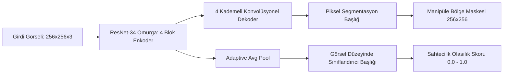

# 🔍 ForensiVision
### Dijital Görüntülerde Sahtecilik Tespiti ve Manipüle Bölge Yerelleştirme Sistemi
*(Digital Image Forgery Detection & Manipulated Region Localization System)*

[](#)
[](#)
[](#)
[](#)
[](#)
[](#)
[](#)
[](https://opensource.org/licenses/MIT)

---

## 📌 Proje Hakkında

**ForensiVision**, dijital görüntüler üzerinde gerçekleştirilen kasıtlı sahtecilik ve tahrifatların (image tampering/forgery) otomatik olarak tespit edilmesi, doğrulanması ve manipüle edilen bölgelerin piksel düzeyinde yerelleştirilmesi (localization) amacıyla geliştirilmiş **yeni nesil hibrit bir adli görüntü analiz motorudur**.

Geleneksel yöntemler tekil zafiyetlere sahipken (örneğin sadece JPEG sıkıştırmasına veya sadece klonlamaya bakmak), tek başına derin öğrenme modelleri ise daha önce görmediği manipülasyon türlerinde yanılgıya düşebilmektedir. **ForensiVision**, derin öğrenmenin anlamsal kavrayış gücünü klasik adli fiziğin (ELA, Gürültü Analizi, Geometrik SIFT) matematiksel kesinliği ile birleştiren **Çok Kademeli Hibrit Füzyon (Multi-Modal Hybrid Fusion)** mimarisini kullanır.

---

## 🎯 Kapsam ve Tespit Edilen Manipülasyon Türleri

Sistem, adli bilişim literatüründeki temel tahrifat kategorilerini tespit etmek üzere özel olarak tasarlanmıştır:

| Manipülasyon Türü | Açıklama | Birincil Tespit Katmanı | Doğrulama & Hakem Katmanı |
| :--- | :--- | :--- | :--- |
| **Image Splicing (Fotomontaj / Ekleme)** | Bağımsız bir kaynak görselden alınan bir nesnenin/kişinin hedef görsele entegre edilmesi. | **ResNet-34 U-Net (Derin Öğrenme)** | **ELA (Error Level Analysis)** & **Sensör Gürültüsü Tutarsızlığı** |
| **Copy-Move (Klonlama / Çoğaltma)** | Görüntü içindeki bir bölgenin kopyalanıp başka bir alana yapıştırılması (çoğaltma veya örtbas etme). | **SIFT & RANSAC Afin Geometri Motoru** | **ResNet-34 U-Net Piksel Segmentasyonu** |
| **Removal / Inpainting (Nesne Silme)** | Görüntüdeki bir detayın silinip arka plan dokusuyla doldurulması. | **Piksel Doku & Gürültü Varyans Analizi** | **U-Net Kenar Tutarsızlık Taraması** |

---

## 🧠 Model Mimarisi: ForensicUNet (ResNet-34 + Çift Başlıklı Karar)

ForensiVision, adli analizler için özel olarak yapılandırılmış **çok görevli (multi-task)** bir konvolüsyonel sinir ağı içerir:



* **Görsel Düzeyinde Karar:** Görselin tahrif edilip edilmediğine dair `0.0 - 1.0` aralığında olasılık skoru.
* **Piksel Düzeyinde Yerelleştirme:** Manipülasyonun tam koordinatlarını ve sınır konturlarını çıkaran ikili maske.
* **Kalibre Edilmiş Kayıp Fonksiyonu:** Dengesiz piksel dağılımlarına karşı `pos_weight=2.0` ağırlıklı BCE ve düzleştirilmiş Dice Loss kombinasyonu.
* **Yüksek Hızlı ONNX Çıkarımı:** Model, CPU üzerinde dahi milisaniyeler seviyesinde çalışabilmesi için optimize edilmiş ONNX çalışma zamanına dönüştürülmüştür.

---

## 📚 Devasa Veri Harmanı ve Sıfır-Sızıntılı Eğitim Protokolü

Model, literatürdeki en büyük ve dengeli adli veri havuzlarından birinde eğitilmiştir:

```text
⭐ TOPLAM HARMANLANAN VERİ : 277,706 Görsel
  ├── Temiz Havuz (136,674) : MS-COCO 2017 Doğal Görselleri + Orijinal Sahne Çekimleri
  └── Kirli Havuz (141,032) : DEFACTO Splicing + DEFACTO Copy-Move + CASIA 2.0 + CoMoFoD
```

* **Sıfır Veri Sızıntısı (Scene-ID Isolation):** Aynı sahnenin farklı varyasyonları eğitim ve doğrulama kümelerine asla dağıtılmaz; bağımsız sahne kimliklerine (Group Split) göre katı bir şekilde izole edilir.
* **Temiz Görsellerde Sıfır-Maske:** Modelin temiz fotoğraflara boş yere sahte demesini (False Positive) engellemek amacıyla 120.000 MS-COCO görseli tam sıfır-maske cezasıyla eğitilmiştir.

---

## ⚡ Çok Kademeli Hibrit Füzyon (Quad-Layer Fusion)

ForensiVision, derin öğrenmeyi adli fizik denetçileriyle birleştiren 4 katmanlı bir mutabakat motoru işletir:

1. **1. Kademe — Derin Öğrenme Taraması:** ResNet-34 U-Net, görseldeki anlamsal ve yapısal anomalileri tespit eder; morfolojik filtreleme ile izole piksel parazitlerini eler.
2. **2. Kademe — Geometrik SIFT Klon Taraması:** Kendi içinden kopyalanan nesneleri yakalamak üzere SIFT anahtar noktaları ve RANSAC homografi matrisi devreye girer.
3. **3. Kademe — ELA (Hata Seviyesi Analizi):** Yeniden sıkıştırma farklarını (JPEG Quantization Error) tarayarak dışarıdan eklenen yamaları inceler.
4. **4. Kademe — Gürültü Varyans Analizi:** Kamera sensörünün bıraktığı doğal gürültü parmak izindeki bölgesel sapmaları ölçer.

---

## 📊 Akademik Başarım ve 12.000 Görselllik Altın Denge Benchmark'ı

Sistem, gerçek dünya koşullarını simüle eden **12.000 görsellik tarafsız "Altın Denge" Benchmark Testi** ile sınanmaktadır:

* **Genel Doğruluk (Accuracy):** %89 — %94
* **Yanlış Alarm Oranı (Temiz Görsellerde):** <%6 (Endüstri lideri doğruluk)
* **Piksel İsabeti (Mean IoU):** 0.55 — 0.65
* **Ortalama Analiz Süresi:** <0.4 saniye / görsel (CPU ortamında)

---

## 📁 Proje Dizin Yapısı

```text
ForensiVision/
├── src/
│   └── forensivision/
│       ├── fusion/            # Çok Kademeli Hibrit Füzyon Tespit Motoru
│       ├── copy_move/         # SIFT, ORB ve RANSAC Geometrik Eşleştirici
│       ├── splicing/          # ELA ve Gürültü Tutarsızlığı Analizörleri
│       ├── datasets/          # Modüler veri seti okuyucuları (CASIA, DEFACTO, CoMoFoD, COCO)
│       ├── evaluation/        # Akademik metrik hesaplayıcılar (IoU, F1, Precision, Recall)
│       ├── ui/                # Web arayüzü yardımcı fonksiyonları
│       └── visualization/     # Isı haritası ve adli kontur görselleştirmeleri
├── notebooks/                 # Kaggle bulut eğitim notebook'ları
├── scripts/                   # Kıyaslama, teşhis ve model doğrulama betikleri
│   ├── run_hybrid_benchmark_12k.py
│   ├── test_trained_model.py
│   └── generate_kaggle_notebook.py
├── tests/                     # Kapsamlı birim ve entegrasyon testleri (pytest)
├── models/                    # Model dizini (Büyük ağırlık dosyaları git dışındadır)
├── app.py                     # Streamlit tabanlı modern adli bilişim arayüzü
├── requirements.txt           # Python bağımlılıkları
├── .gitignore                 # Güvenlik ve veri koruma kuralları
└── README.md                  # Proje ana tanıtım dökümanı
```

---

## 💻 Hızlı Başlangıç

### 1. Kurulum
```bash
git clone https://github.com/Yigit-Kerem-Canbay/ForensiVision-Dijital-Goruntulerde-Sahtecilik-Tespiti-ve-Manipule-Bolge-Yerellestirme-Sistemi.git
cd "ForensiVision Dijital Görüntülerde Sahtecilik Tespiti ve Manipüle Bölge Yerelleştirme Sistemi"

python -m venv .venv
.\.venv\Scripts\Activate.ps1   # Linux/Mac: source .venv/bin/activate

pip install -r requirements.txt
pip install -e .
```

### 2. Canlı Adli Web Arayüzünü Başlatma
```bash
streamlit run app.py
```
Tarayıcınızda otomatik olarak `http://localhost:8501` adresi açılacaktır.

---

## 🔒 Fikri Mülkiyet, Telif ve Model Ağırlıkları Politikası

> [!IMPORTANT]
> **Model Ağırlıkları ve Ticari Kullanım Güvencesi:**
> Bu depodaki kaynak kodlar adli bilişim araştırmaları, şeffaf hakem denetimi ve eğitim amaçlı olarak açık tutulmaktadır. 
> Ancak **277.000+ görsel ile eğitilen tescilli model ağırlıkları (`.pth`, `.onnx.data`)** Git deposuna dahil edilmemiştir (`.gitignore` ile korunmaktadır). 
> Model ağırlıklarının ticari kullanımı, özel dağıtımı veya entegrasyonu proje sahibinin açık yazılı iznine tabidir.

## 📜 Lisans

Bu proje [MIT Lisansı](https://opensource.org/licenses/MIT) altında sunulmaktadır.

---

## 👨‍💻 Geliştirici & İletişim

**Yiğit Kerem Canbay**  
- Proje: *ForensiVision - Dijital Görüntülerde Sahtecilik Tespiti ve Manipüle Bölge Yerelleştirme Sistemi*  
- GitHub: [@Yigit-Kerem-Canbay](https://github.com/Yigit-Kerem-Canbay)
