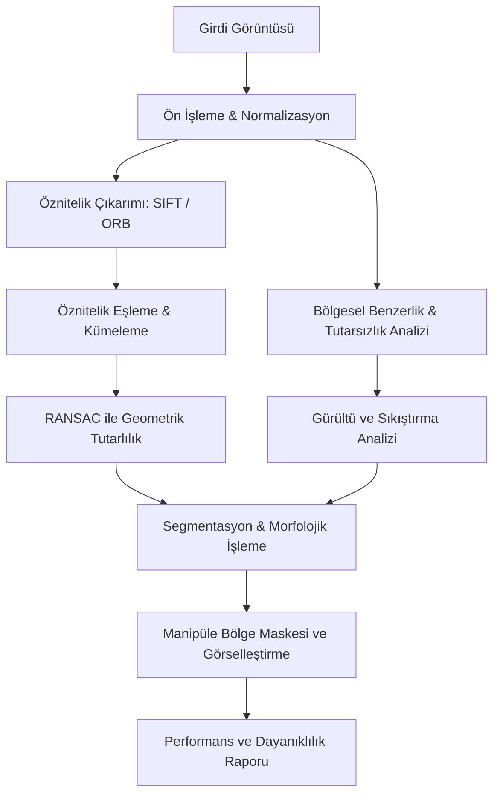

# 🔍 ForensiVision
### Dijital Görüntülerde Sahtecilik Tespiti ve Manipüle Bölge Yerelleştirme Sistemi
*(Digital Image Forgery Detection & Manipulated Region Localization System)*

[](#)
[](#)
[](#)
[](#)
[](#)

---

## 📌 Proje Hakkında

**ForensiVision**, dijital görüntüler üzerinde gerçekleştirilen kasıtlı sahtecilik ve tahrifatların (image tampering/forgery) otomatik olarak tespit edilmesi, doğrulanması ve tahrif edilen bölgelerin piksel/bölge düzeyinde yerelleştirilmesi (localization) amacıyla geliştirilmekte olan bir adli görüntü analiz sistemidir.

Günümüzde gelişmiş görüntü işleme yazılımları ve yapay zeka araçları ile manipüle edilen dijital içerikler; adli vakalarda, haber doğrulama süreçlerinde, sigorta ekspertizlerinde ve telif hakkı korumasında ciddi güvenilirlik sorunları yaratmaktadır. Bu sistem; insan gözüyle fark edilemeyen piksel anomalilerini, öznitelik tutarsızlıklarını ve geometrik izleri tespit ederek güvenilir, doğrulanabilir ve ölçülebilir bir kanıt çıktısı üretmeyi hedefler.

---

## 🎯 Kapsam ve Tespit Edilen Manipülasyon Türleri

Sistem öncelikli olarak adli bilişim literatüründeki iki ana tahrifat kategorisine odaklanmaktadır:

| Manipülasyon Türü | Açıklama | Analiz Yaklaşımı |
| :--- | :--- | :--- |
| **Copy-Move (Klonlama)** | Görüntünün kendi içindeki bir alanın kopyalanıp başka bir bölgeye yapıştırılması (çoğunlukla nesne çoğaltma veya silme amacıyla). | Anahtar nokta (keypoint) eşleştirme, blok tabanlı öznitelik analizi, RANSAC ile afinite dönüşüm tutarlılığı. |
| **Image Splicing (Ekleme / Montaj)** | Başka bir bağımsız kaynak görüntüden alınan bir parçanın hedef görüntüye entegre edilmesi. | Kenar/sınır tutarsızlıkları, bölgesel gürültü analizleri (Noise Inconsistency), parlaklık ve aydınlatma anomalileri. |

---

## ⚙️ Yöntem ve Teknik Yaklaşım

ForensiVision, klasik görüntü işleme ve modern bilgisayarla görme tekniklerini çok katmanlı bir analiz boru hattında birleştirmektedir:



1. **Öznitelik Çıkarımı ve Eşleştirme (Feature Extraction & Matching):**
   - Ölçek ve rotasyondan bağımsız öznitelik çıkarımı için **SIFT** (*Scale-Invariant Feature Transform*) ve yüksek işlem hızı gerektiren adımlar için **ORB** (*Oriented FAST and Rotated BRIEF*) algoritmaları.
   - Benzer anahtar noktaların eşlenmesi ve yalancı pozitiflerin filtrelenmesi.

2. **Geometrik Tutarlılık Doğrulaması:**
   - **RANSAC** (*Random Sample Consensus*) algoritması ile eşleşen bölgeler arasındaki geometrik dönüşümlerin (öteleme, rotasyon, ölçekleme) tutarlılığı denetlenir; rastgele/gürültülü eşleşmeler ayıklanır.

3. **Görüntü Tutarsızlığı ve Bölgesel Analiz:**
   - Farklı kaynaklardan birleştirilen parçaların yarattığı yerel gürültü tutarsızlıkları, hata seviyesi analizleri (ELA) ve bölgesel doku farkları incelenir.

4. **Segmentasyon ve Morfolojik İşleme:**
   - Tespit edilen şüpheli noktaların etrafı morfolojik operatörler (genişletme, aşındırma, kapanış) ve segmentasyon teknikleri ile taranarak tahrif edilen bölgenin kesintisiz sınırları belirlenir.

5. **Görsel Çıktı ve Yerelleştirme (Localization):**
   - Şüpheli bölgeler **ikili maske (binary mask)**, **ısı haritası (heat-map)** ve **çerçeveleme (bounding-box/overlay)** görselleştirmeleri ile adli raporlama formatında sunulur.

---

## 📊 Başarım Değerlendirme ve Akademik Metrikler

Sistemin doğruluğu ve başarımı, ground-truth (gerçek manipülasyon maskeleri) bulunan akademik referans veri setleri üzerinde piksel ve nesne bazında test edilecektir:

- **IoU (Intersection over Union / Jaccard Index):** Tespit edilen bölge ile gerçek manipüle bölgenin örtüşme kalitesi.
- **Precision (Kesinlik):** Sistemce sahte olarak işaretlenen alanların gerçekte sahte olma oranı.
- **Recall (Duyarlılık):** Görüntüdeki gerçek manipülasyonların sistem tarafından yakalanma oranı.
- **F1-Score:** Precision ve Recall arasındaki harmonik denge.

---

## 🛡️ Dayanıklılık (Robustness) Testleri

Saldırganlar veya sosyal medya platformları manipülasyon izlerini gizlemek amacıyla ikincil işlemler uygulayabilmektedir. ForensiVision, aşağıdaki deformasyonlar altında test edilecektir:

- 🔄 **Döndürme (Rotation)** (Farklı açılarda döndürme etkileri)
- 🔍 **Ölçekleme (Scaling)** (Büyütme/küçültme operasyonları)
- 🗜️ **JPEG Sıkıştırması (Compression)** (Düşük kalite faktörlerinde sıkıştırma)
- 🌫️ **Bulanıklaştırma (Blurring)** (Gaussian, Median, Motion blur)
- ⚡ **Gürültü Ekleme (Noise Injection)** (Gaussian, Salt & Pepper gürültüleri)

---

## 📁 Proje Dizin Yapısı

```text
ForensiVision/
├── docs/                      # Raporlar, mimari dökümanlar ve analizler
├── src/
│   └── forensivision/         # Ana Python paketi
│       ├── copy_move/         # Copy-Move tespiti ve yerelleştirme (SIFT/ORB + RANSAC)
│       ├── splicing/          # Image Splicing tespiti ve analizi (Gürültü/ELA)
│       ├── evaluation/        # Değerlendirme metrikleri (Precision, Recall, F1, IoU)
│       ├── datasets/          # Modüler veri seti okuyucuları (CoMoFoD, Columbia, Base, Manifest)
│       └── visualization/     # Maske ve adli tespit görselleştirmeleri
├── tests/                     # Birim ve doğrulama testleri (pytest - 47 test)
├── scripts/                   # Yardımcı veri hazırlama, sentetik demolar ve deney betikleri
│   ├── demo_synthetic_copy_move.py
│   ├── demo_synthetic_splicing.py
│   └── evaluate_dataset.py    # Tekrarlanabilir toplu değerlendirme ve raporlama betiği
├── data/
│   ├── raw/                   # Ham veri setleri (comofod, columbia, casia, defacto) [Git dışı]
│   ├── manifests/             # Veri seti indeks ve manifest dosyaları (JSON/CSV)
│   ├── output/experiments/    # Deney çıktıları, metrik tabloları ve raporlar [Git dışı]
│   ├── interim/               # Ara işlenmiş görüntüler/öznitelikler [Git dışı]
│   └── processed/             # Sonuç maskeleri ve test çıktıları [Git dışı]
├── pyproject.toml             # Paketleme ve pytest yapılandırması
├── requirements.txt           # Temel bağımlılıklar
├── .gitignore                 # Git dışlama kuralları (veri setlerini ve ağır çıktıları korur)
└── README.md                  # Proje ana tanıtım dökümanı
```

---

## 🧪 Tekrarlanabilir Deney ve Veri Seti Değerlendirme Altyapısı (Aşama 5)

ForensiVision, algoritmaların başarısını doğrulamak için akademik standartlarda, deterministik ve CPU dostu bir deney çerçevesi sunar:

### 1. Desteklenen Veri Setleri ve Yerel Klasörleme
- **CoMoFoD (University of Zagreb):** Copy-Move manipülasyonları ve 10 farklı saldırı varyantı (`data/raw/comofod/`).
- **Columbia Color Splicing (Columbia DVMM):** Sıkıştırılmamış TIFF formatında montaj görüntüleri ve kenar maskeleri (`data/raw/columbia/`).
- **CASIA & DEFACTO:** Gelecek genişlemeler için altyapı klasörleri hazırlanmıştır (`data/raw/casia/`, `data/raw/defacto/`).

> [!NOTE]
> Akademik kullanım ve lisans koşulları gereği ham veri seti görüntüleri Git deposuna dahil edilmez ve otomatik indirilmez. İlgili veri setleri resmi kaynaklarından temin edilerek `data/raw/<dataset_adi>/` dizinine yerleştirilmelidir.

### 2. Değerlendirme İlkeleri ve Protokol
- **Veri Sızıntısını Önleme (Data Leakage Prevention):** CoMoFoD gibi veri setlerinde aynı temel görselin dönüşümleri `group_id` ile kümelenir; varyantların ayrışması engellenir.
- **Temiz Görüntü Ayrımı (Authentic / False Alarm Separation):** Gerçek maskesi boş olan özgün görüntüler, manipüle edilmiş görüntülerin makro IoU/F1 metriklerine dahil edilmez; ayrı bir **Yanlış Alarm Oranı (False Alarm Rate - FAR)** tablosunda raporlanır.
- **Makro ve Mikro Metrikler:** Hem örnek bazlı ortalama (Macro) hem de toplam piksel sayımlarından türetilen genel skor (Micro) üretilir.
- **Hata Toleransı:** Bozuk veya okunamayan görüntüler deneyi kırmaz; `failures.csv` dosyasına kaydedilerek deney sürdürülür.

### 3. Değerlendirme Komutunun Çalıştırılması
Örnek CPU kontrollü pilot deney (30 örnek, deterministik tohum 42):
```bash
python scripts/evaluate_dataset.py --dataset comofod --root data/raw/comofod --limit 30 --seed 42 --output data/output/experiments/comofod_pilot
```

Üretilen Deney Çıktıları:
- `metrics.csv`: Her görüntü için Precision, Recall, F1, IoU, TP, FP, FN ve süre.
- `summary.json`: Tüm deneyin makine tarafından okunabilir metaveri ve parametre özeti.
- `report.md`: Markdown formatında akademik özet raporu.
- `failures.csv`: İşlenemeyen örnekler ve hata detayları.
- `examples/`: Doğruluk maskesi, tahmin ve bindirme (overlay) karşılaştırma görselleri.

---

## 💻 Geliştirme Ortamı ve Kurulum (Windows)

### 1. Sanal Ortamı Etkinleştirme
Windows PowerShell üzerinde:
```powershell
.\.venv\Scripts\Activate.ps1
```
*(Komut İstemi / CMD için: `.\.venv\Scripts\activate.bat`)*

> [!TIP]
> Eğer PowerShell üzerinde betik çalıştırma yetki uyarısı (*execution policy*) alırsanız, geçici olarak yetki vermek için:
> `Set-ExecutionPolicy -ExecutionPolicy RemoteSigned -Scope Process` komutunu çalıştırabilirsiniz.

### 2. Bağımlılıkların Kurulumu ve Paket Kaydı
```bash
pip install -r requirements.txt
pip install -e .
```

### 3. Testlerin Çalıştırılması
Tüm birim ve entegrasyon testlerini (47 test) çalıştırmak için:
```bash
pytest
```

---

## 🚀 Geliştirme Süreci ve Yol Haritası

- [x] **Aşama 1 — Proje Altyapısı:** Modüler paket mimarisi, sanal ortam, `.gitignore`, bağımlılık yönetimi ve smoke testleri tamamlandı.
- [x] **Aşama 2 — Değerlendirme Motoru:** Precision, Recall, F1-Score ve IoU piksel maske karşılaştırma testleri tamamlandı.
- [x] **Aşama 3 — Copy-Move Modülü:** SIFT öznitelik çıkarımı, öz-eşleme filtreleme, RANSAC afin doğrulama ve morfolojik bölge maskeleme prototipi tamamlandı.
- [x] **Aşama 4 — Splicing Modülü:** Error Level Analysis (ELA) ve Gürültü Tutarsızlığı (Noise Inconsistency) analiz motoru ve füzyon prototipi tamamlandı.
- [x] **Aşama 5 — Veri Seti Altyapısı ve Tekrarlanabilir Deneyler:** CoMoFoD ve Columbia veri adaptörleri, manifest oluşturucu, makro/mikro metrik raporlayıcı, temiz görüntü ayrımı ve dayanıklı test altyapısı tamamlandı. *(Gerçek veri setlerinin yerel klasöre indirilip yerleştirilmesiyle tam deneyler çalıştırılabilir durumdadır).*
- [ ] **Aşama 6 — Arayüz ve Sunum:** Canlı adli analiz ve görsel maskeleme Streamlit arayüzü.


---

## 👨‍💻 Geliştirici & İletişim

**Yiğit Kerem Canbay**  
- Proje: *ForensiVision - Dijital Görüntülerde Sahtecilik Tespiti ve Manipüle Bölge Yerelleştirme Sistemi*  
- GitHub: [@Yigit-Kerem-Canbay](https://github.com/Yigit-Kerem-Canbay)
